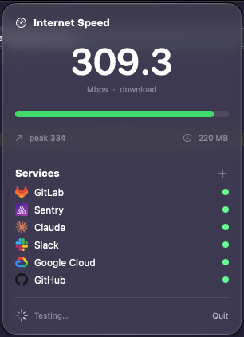

# NetPulse

Your internet speed and the health of the services you depend on, one click away in the macOS menu bar.

<p align="center">
  
</p>

## Features

- **Live download speed.** Open the dropdown and the test starts: current Mbps, a live bar, peak speed and data used. Close it and the test stops. The last reading stays in the menu bar.
- **Service status at a glance.** A green, orange, red or gray dot for each service. Comes with GitLab, Sentry, Claude, Slack and Google Cloud.
- **Add any status page.** Click **+** and paste a status page URL. NetPulse detects the provider for you:
  - Atlassian Statuspage
  - status.io
  - Instatus
  - Slack and Google Cloud
- **Click a service** to open its status page. Right-click to open the product site or remove it.

## Install

Requirements: macOS 13+, Swift 5.9+ (Xcode or the command line tools).

> If the build fails with `external macro implementation type 'SwiftUIMacros.StateMacro' could not be found`, your command line tools use an SDK whose SwiftUI macros they don't ship. Install Xcode, or point to an older SDK: `SDKROOT=$(xcrun --show-sdk-path --sdk macosx26.5) ./install.sh`.

```sh
./install.sh
```

This builds a release, copies `NetPulse.app` to `/Applications` and launches it. Pass another folder to install elsewhere: `./install.sh ~/Applications`.

## Configure

Services live in `~/.config/netpulse/services.json`. The app writes it when you add or remove a service, and you can edit it by hand:

```json
[
  {
    "endpoint": "https://status.sentry.io/api/v2/status.json",
    "name": "Sentry",
    "provider": "statuspage",
    "site": "https://sentry.io",
    "statusPage": "https://status.sentry.io"
  }
]
```

`provider` is one of `statuspage`, `statusio`, `instatus`, `slack`, `googleCloud`. If the file can't be read, NetPulse moves it to `services.json.broken` and starts from the defaults, so your edits are never lost.

## How it works

- **Speed:** 6 parallel downloads from Cloudflare's speed endpoint, sampled every 0.2 s and smoothed.
- **Status:** each service's public status API is polled when the dropdown opens.

## Privacy & notes

- **No tracking, no analytics.** NetPulse only talks to the services below.
- **Favicons come from DuckDuckGo** (`icons.duckduckgo.com`), so the hosts of the services you track are sent to it.
- **The speed test uses real bandwidth.** It downloads from Cloudflare's undocumented `speed.cloudflare.com/__down` endpoint, which may change or stop working. Each test stops after 15 seconds, or sooner when you close the dropdown. On a fast link that can still be a few hundred MB, so mind metered connections.

## License

[MIT](LICENSE) © 2026 Vivien Meyet
